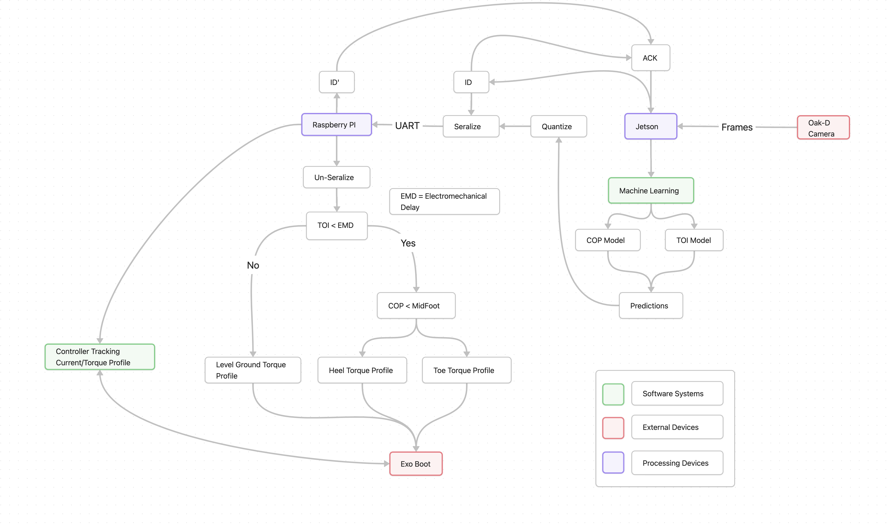

Run test_1_law.py to test it out.
# Goal
Prototype a codebase what will allow the system to integrate computer vision and actuate different torque profiles on stairs depending on the COP.

## Status
- Currently we have written backbone code for this process of integration
- We integrated alpha toe and heel strike torque profiles (eventually this should be COP --> profile or much more granular)
- We have setup a communication protocol which interoperates between the Jetson (sender) and Rasp Pi (receiver + exo controller)
   - Works with a latency of 0.05ms and 60 FPS on the camera + model (jetson)
- If the TOI prediction is greater than the electromechanical delay (EMD) then we use the level ground profile
- If the TOI prediction is less than or equal to the EMD then, based on the COP prediction, we determine if we should use the toe or heel profile (based on the COP prediction relative to the mid-foot).
   - Again this should eventually be much more granular, but we need to find that mapping between COP and torque profiles first.
- We had to remove some parts of the code that does the actual actuation since I don't have access to the exoboot itself.

## Connection (brief)
- Connect bare-metal UART pins to the Jetson and USB to the rasp-pi
   - The bare-metal pins you use depend on the Jetson. On my j401 carrier board its pins 8 and 10 for TX and RX respectively on UART1
- Connect the oak-d camera to a USB port on the Jetson
- Ensure that you set the latency timer to 1ms instead of the default 16ms on the rasp-pi [impacts latency significantly]
- run `sudo jetson_clocks` on the jetson

## Todos
- Run experiment to find COP --> torque curve mapping (right now we only have toe v heel v mid)
- Need to also understand how we want to handle swing phase on the stairs
- We also need to figure out a new way to compute the gait cycle % when on stairs. Here they used one which I presume is only for level ground as it seems to depend on heel-strikes (which may not occur here)
- Also need to quantify system electromechanical delay, which allows us to determine when we use a given COP prediction.

# Flowchart

